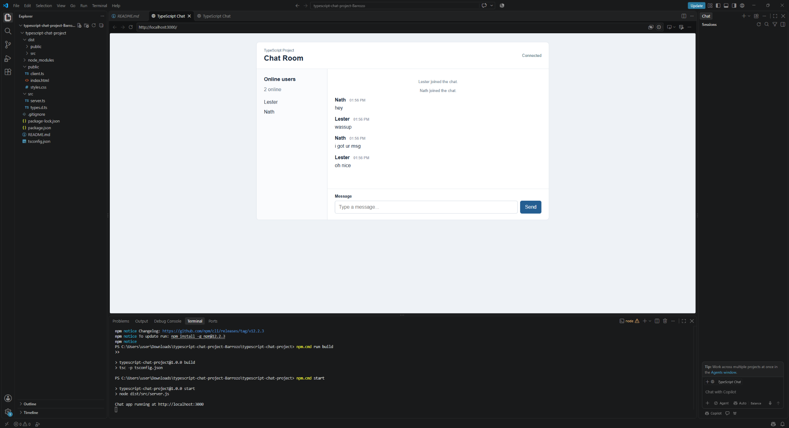

# TypeScript Chat Room

**Name:** Kheen Lester C. Barrozo  
**Section:** BSIT-4A

A simple real-time chat application based on the chat app shown in Simplilearn's TypeScript project material. Several people can open it in separate browser tabs, enter their names, see who's online, and exchange messages. It uses TypeScript, Node.js, Express, and Socket.IO. This implementation also validates names and messages and shows join/leave notices.

## Requirements

- Node.js 18 or later and npm

## Install and run

```bash
npm install
npm run build
npm start
```

Open **http://localhost:3000** in two browser tabs. Join with two different names and send a message from each tab. Both tabs should show the messages and the online users. Stop the server with Ctrl+C.

On Windows PowerShell, if script execution is blocked, run the equivalent commands:

```powershell
npm.cmd install
npm.cmd run build
npm.cmd start
```

The build command compiles the `.ts` files into `dist/`. No generated files or `node_modules` need to be committed.

## Screenshot of the project running

The screenshot shows the chat app at `http://localhost:3000` with two connected users. The VS Code terminal also shows the successful TypeScript build and running server.



## Project structure

- `src/server.ts` - Express server and typed Socket.IO chat events
- `src/types.d.ts` - shape of a chat message shared with browser code
- `public/client.ts` - browser chat logic
- `public/index.html` and `public/styles.css` - page layout

## What I added

The chat displays join and leave notices, checks message length on the server, and remembers the most recent 30 messages for a newly joined user. These features help make the project usable when several users connect.

## Course reference

- [Simplilearn TypeScript Basics](https://www.simplilearn.com/free-typescript-course-skillup)
- [Simplilearn chat application tutorial](https://www.simplilearn.com/tutorials/programming-tutorial/chat-application-typescript-project-using-nodejs-server)

Study the Lesson 8 video and type/adapt the code yourself before treating this as your class project. The public course listing confirms the lesson title and length, but this project has not been compared frame by frame with the logged-in video.
